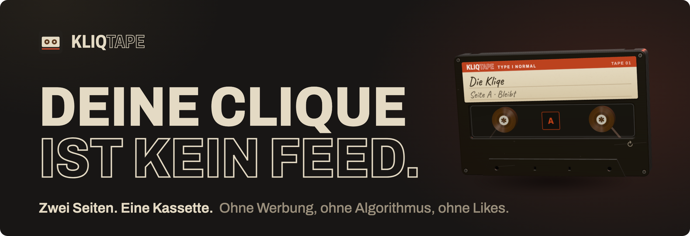

 

**Kliqtape ist ein soziales Netz für kleine, feste Runden.** Ein Regal voller Kassetten: Jede steht für eine Runde von dir und deinen Leuten. Du legst die ein, mit der du gerade redest, und die Kreise vermischen sich nie.

Die meisten sozialen Netze sind für Reichweite gebaut und verkaufen Aufmerksamkeit. Kliqtape ist für Nähe gebaut und verkauft nichts.

### Zwei Seiten. Eine Kassette.

**Seite A bleibt.** Das Archiv eurer Runde: Fotoabzüge, Zettel, O-Töne und Mixtapes, nach Tagen gebündelt.

**Seite B läuft weiter.** Der Gruppenchat eurer Runde, für alles, was gerade im Fluss ist. Ein Tipp auf den Schalter dreht die Kassette um.

### Worauf Kliqtape verzichtet

- **Keine Werbung.** Wir verkaufen weder deine Aufmerksamkeit noch deine Daten.
- **Kein Tracking.** Keine Analyse-Tools, keine Werbe-IDs, keine Profile über dich.
- **Kein Algorithmus.** Alles läuft chronologisch. Niemand entscheidet, was du zuerst siehst.
- **Keine Likes und keine Zahlen.** Unter Beiträgen steht nichts zum Zählen. Statt eines Likes schickst du einen Tonfetzen, eine kurze Sprachreaktion, die nur die Person hört, die gepostet hat.
- **Keine Follower und keine Reichweite.** Es gibt kein öffentliches Profil. Dein Profil sieht nur du.
- **Kein endloser Feed.** Wenn du alles gesehen hast, kommt das Bandende.

### Offen gebaut

Der Code steht unter der **AGPL-3.0**. Kliqtape läuft als ganz normaler Dienst, Vereine, Hochschulgruppen und andere Communities dürfen aber auch eine eigene Instanz betreiben. Gerade gibt es einen funktionierenden Web-Prototyp, daraus wird eine native App.

### Zur App

**[kliqtape/kliqtape](https://github.com/kliqtape/kliqtape)**: Code, Screens, Doku und wie du mitmachst. 
**[kliqtape.de](https://kliqtape.de)**: die Website.

 

**In short:** Kliqtape is an ad-free, algorithm-free social app for small, fixed groups of friends. Every group is a cassette: side A is the group's lasting archive, side B its ongoing group chat. No ads, no tracking, no likes, no followers. Open source under AGPL-3.0.

Name, Logo und Icon von Kliqtape sind von der Code-Lizenz ausgenommen, Details in [TRADEMARKS.md](https://github.com/kliqtape/kliqtape/blob/main/TRADEMARKS.md).
