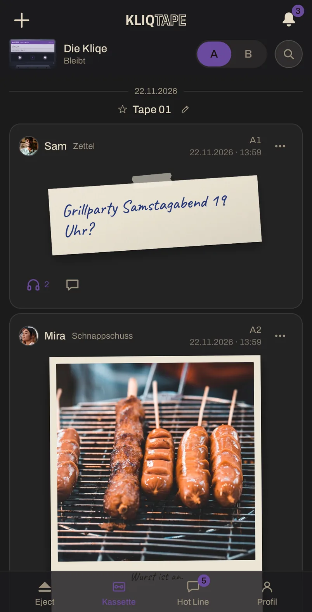
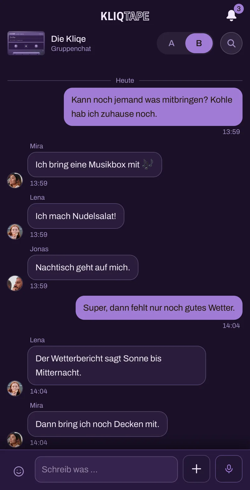
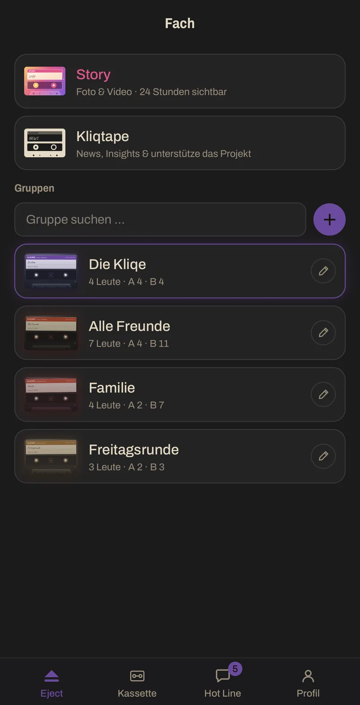
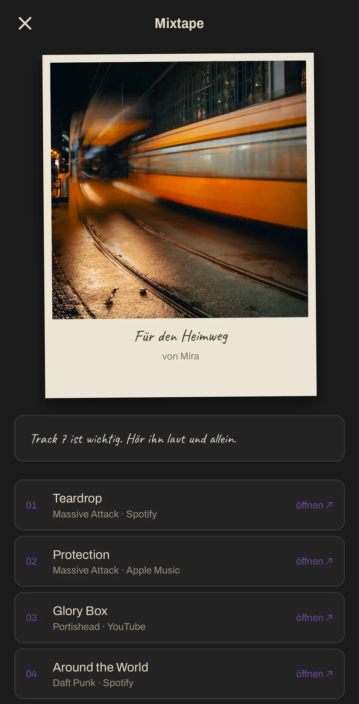

 

**Kliqtape ist ein soziales Netz für kleine, feste Runden.** Ein Regal voller Kassetten: Jede steht für eine Runde von dir und deinen Leuten. Du legst die ein, mit der du gerade redest, und die Kreise vermischen sich nie.

Die meisten sozialen Netze sind für Reichweite gebaut und verkaufen Aufmerksamkeit. Kliqtape ist für Nähe gebaut und verkauft nichts.

### Zwei Seiten. Eine Kassette.

**Seite A bleibt.** Das Archiv eurer Runde: Fotoabzüge, Zettel, O-Töne und Mixtapes, nach Tagen gebündelt, mit Track-Nummern statt Zeitdruck.

**Seite B läuft weiter.** Der Gruppenchat eurer Runde, für alles, was gerade im Fluss ist. Ein Tipp auf den Schalter dreht die Kassette um.

  
  
  
  

Seite A · Seite B · Das Fach · Ein Mixtape

### Was es hier nicht gibt

Keine Follower, keine Likes, keine Zahlen unter Beiträgen, keine Werbung, kein Tracking, keinen Algorithmus und keinen endlosen Feed. Alles läuft chronologisch. Statt eines Likes schickst du einen Tonfetzen, eine kurze Sprachreaktion, die nur die Person hört, die gepostet hat. Dein Profil sieht nur du.

### Offen gebaut

Kliqtape läuft als ganz normaler Dienst, niemand muss einen Server aufsetzen. Der Code steht unter der **AGPL-3.0**, deshalb dürfen Vereine, Hochschulgruppen und andere Communities auch eine eigene Instanz betreiben. Wir sind ehrlich darüber, was der Server sieht, heute im Prototyp und als Ziel. Seite B soll Ende-zu-Ende-verschlüsselt laufen, mit dem Signal-Protokoll.

Gerade gibt es einen funktionierenden Web-Prototyp (PWA). Daraus wird eine native App, im Moment in geschlossener Beta auf Einladung.

### Leg deine Runde ein

- **[kliqtape.de](https://kliqtape.de)**: die Website, bald mit Warteliste
- **[kliqtape/kliqtape](https://github.com/kliqtape/kliqtape)**: der Code, die Doku und wie du mitmachst

 

**In short:** Kliqtape is an ad-free, algorithm-free social app for small, fixed groups of friends. Every group is a cassette: side A is the group's lasting archive, side B its ongoing group chat. No followers, no likes, no feed ranking. Open source under AGPL-3.0.

Name, Logo und Icon von Kliqtape sind von der Code-Lizenz ausgenommen, Details in [TRADEMARKS.md](https://github.com/kliqtape/kliqtape/blob/main/TRADEMARKS.md).
